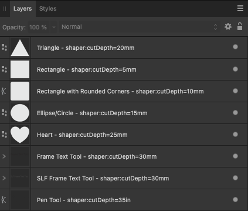

# **Note: This project is not affiliated with Shaper Tools.**

# Affinity and Shaper Origin/Studio Integration Tools

This repository contains two tools for working with SVG files between Affinity (Designer 2 and Affinity 3) and Shaper Studio:

- `af2so`: Converts Affinity SVG files to Shaper Origin format
- `ss2af`: Converts Shaper Studio SVG files back to Affinity layer ids

Both commands need Python 3.11 or newer. Check with `python3 --version`.

## Setup for non-developers

Use this when you only want to convert SVG files.

1. Download this project and open a terminal in that folder.
2. Create a virtual environment and install the tools:

```bash
python3 -m venv .venv
source .venv/bin/activate
python3 -m pip install .
```

On Windows, activate with `.venv\Scripts\activate` instead of `source .venv/bin/activate`.

3. Convert a file. Paths can be anywhere on your computer:

```bash
af2so -i /path/to/design.svg -o /path/to/design-shaper.svg
ss2af -i /path/to/design-shaper.svg -o /path/to/design-affinity.svg
```

Open a new terminal later with `source .venv/bin/activate` before running `af2so` or `ss2af`. You can also call the commands without activating:

```bash
.venv/bin/af2so -i /path/to/design.svg -o /path/to/design-shaper.svg
```

On Windows that program is `.venv\Scripts\af2so`.

## Setup for developers

Use this when you will change the code. Edits under `src/shaperorigin/` are picked up without reinstalling.

```bash
git clone https://github.com/alanlcurry/ShaperOrigin.git
cd ShaperOrigin
python3 -m venv .venv
source .venv/bin/activate
python3 -m pip install -e .
python3 tests/run_tests.py
```

On Windows, activate with `.venv\Scripts\activate`. Run the tests again after a change. `python3 tests/run_tests.py` should print `All tests passed`.

## af2so - Affinity to Shaper Origin Converter

`af2so` applies Shaper Origin attributes to an SVG exported from Affinity Designer 2 or Affinity 3. Designer 2 stores the layer name in `serif:id` (`http://www.serif.com/`). Affinity 3 stores it in `affinity:id` (`https://www.affinity.studio/`). The converter reads either attribute. Output always declares both `xmlns:serif` and `xmlns:affinity`. Shaper Studio's webpage renders with the serif namespace. This tool was inspired by the Shaper Community forum thread [Depth encoding via Fusion360 (PLEASE LOCK THREAD)](https://community.shapertools.com/t/depth-encoding-via-fusion360-please-lock-thread/10075)

### Specifying Attributes in Affinity

To specify a Shaper Origin attribute, add the attribute name and value to the object's layer name in Affinity Designer 2 or Affinity 3. Example:



When Affinity exports to SVG, the layer name is stored in `serif:id` (Designer 2) or `affinity:id` (Affinity 3).

Designer 2:

    <path id="Triangle---shaper:cutDepth-20mm" serif:id="Triangle - shaper:cutDepth=20mm" d="M1258.58,113.386L1383.31,340.157L1133.86,340.157L1258.58,113.386Z" style="fill:rgb(231,232,233);"/>

Affinity 3:

    <path id="Triangle---shaper:cutDepth-20mm" affinity:id="Triangle - shaper:cutDepth=20mm" d="M1258.58,113.386L1383.31,340.157L1133.86,340.157L1258.58,113.386Z" style="fill:rgb(231,232,233);"/>

When processing the exported SVG file, af2so searches each element for `shaper:` tokens in `serif:id` or `affinity:id`. If found, the shaper attribute(s) are added to the element.<br>
Example (scroll all the way to the right to see the shaper: attribute):

    <path id="Triangle---shaper:cutDepth-20mm" serif:id="Triangle - shaper:cutDepth=20mm" d="M1258.58,113.386L1383.31,340.157L1133.86,340.157L1258.58,113.386Z" style="fill:rgb(231,232,233);" shaper:cutDepth="20mm" />

### Affinity Groups

Shaper Origin attributes can be set at the group level. The attributes only apply to that group of elements. Shaper: attributes specified on a specific layer will override the group level shaper: attributes.

**Group Notes:** 

- Frame Text Tool layers must be in a group for shaper: attributes to be specified for the text.
- If a group is within a group, the shaper: attribute has to applied to the group name that contains the objects.

Example: 


### Global Attributes

Shaper Origin attributes can be set at the global level. Global attributes are added to each element before the shaper: attributes set on the Affinity layer. Global attributes are specified on the command line. See below for more information. 

### Processing

Processing is performed by executing the Python script with command line options. The command line options are as follows:  

    options:
        -h, --help            show this help message and exit
        -i INFILE, --inFile INFILE
                        Input SVG file(s). Supports wildcards (e.g., *.svg).
        -o OUTFILE, --outFile OUTFILE
                Output file or directory (optional). If omitted, a
                '-converted' file is created alongside the input.
        -g [GBLATTR ...], --gblAttr [GBLATTR ...]
                        Global shaper attributes to apply (optional).

Example invocations:

    Affinity 3 export:
        af2so -i examples/Example-AF.svg -o examples/Example-AF-shaper.svg

    Affinity Designer 2 export:
        af2so -i examples/Example-AD2.svg -o examples/Example-AD2-shaper.svg

    With global attributes:
        af2so -i examples/Example-AF.svg -o examples/Example-AF-shaper.svg -g shaper:cutDepth=15mm

    Multiple global attributes:
        af2so -i examples/Example-AF.svg -o examples/Example-AF-shaper.svg -g "shaper:cutDepth=15mm" "shaper:toolDia=0.25in"

    Process multiple files using wildcards:
        af2so -i examples/*.svg               # Creates *-converted.svg for each file
        af2so -i examples/*.svg -o output_dir # Saves converted files in output_dir

    Using the project virtual environment directly:
        .venv/bin/af2so -i examples/Example-AF.svg -o examples/Example-AF-shaper.svg

## ss2af - Shaper Studio to Affinity Converter

`ss2af` converts Shaper Studio SVG files back to a form Affinity can show in the layer panel. It takes any shaper: attributes in the SVG file and concatenates them into the ID field.

For example, it converts:

    <path d="..." shaper:cutDepth="20mm" shaper:cutType="outside" />

To:

    <path d="..." id="shaper:cutDepth=20mm shaper:cutType=outside" />

This preserves the Shaper Studio settings while making them visible and editable in the Affinity layer panel.

## Usage

Both tools support similar command-line options:

### af2so Options

    -h, --help            Show this help message and exit
    -i INFILE, --inFile INFILE
                         Input SVG file(s). Supports wildcards (e.g., *.svg).
    -o OUTFILE, --outFile OUTFILE
                         Output file or directory (optional). If omitted, a
                         '-converted' file is created alongside the input.
    -g [GBLATTR ...], --gblAttr [GBLATTR ...]
                         Global shaper attributes to apply (optional).

### ss2af Options

    -h, --help            Show this help message and exit
    -i INFILE, --inFile INFILE
                         Input SVG file(s). Supports wildcards (e.g., *.svg).
    -o OUTFILE, --outFile OUTFILE
                         Output file or directory (optional). If omitted, a
                         '-converted.svg' file is created alongside the input.

### Example Usage

Single file processing:
```bash
# Affinity 3 export (affinity:id)
af2so -i examples/Example-AF.svg -o examples/Example-AF-shaper.svg

# Affinity Designer 2 export (serif:id)
af2so -i examples/Example-AD2.svg -o examples/Example-AD2-shaper.svg

# Same conversion through the project virtual environment
.venv/bin/af2so -i examples/Example-AF.svg -o examples/Example-AF-shaper.svg

# Convert from Shaper Studio back to Affinity
ss2af -i examples/Example-AF-shaper.svg -o examples/Example-Affinity.svg
```

Process multiple files using wildcards:
```bash
# Convert all SVG files in a directory to Shaper Origin format
af2so -i examples/*.svg
af2so -i examples/*.svg -o output_dir

# Convert all Shaper Studio files in a directory back to Affinity format
ss2af -i examples/*.svg
ss2af -i examples/*.svg -o output_dir
```

With global attributes (af2so only):
```bash
# Single global attribute
af2so -i examples/Example-AF.svg -o examples/Example-AF-shaper.svg -g shaper:cutDepth=15mm

# Multiple global attributes
af2so -i examples/Example-AF.svg -o examples/Example-AF-shaper.svg -g shaper:cutDepth=15mm shaper:toolDia=0.25in
```

### Auto-naming Convention

When processing files, both programs automatically:
- Add "-converted" suffix to output filenames
- Skip any files that already have "-converted" in their name
- When using wildcards without -o, create files in the same directory as input
- When using wildcards with -o, save files in the specified directory

### Color to Cut Type Mapping (af2so only)

The af2so program automatically maps colors to Shaper cut types:
- Black → outside
- White → inside
- Grey → pocket
- None+Grey → online
- Dodger Blue → guide
- Red → anchor