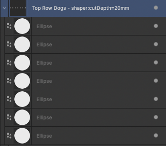

# **Note: This project is not affiliated with Shaper Tools.**

# Affinity and Shaper Origin/Studio Integration Tools

This repository contains two tools for working with SVG files between Affinity (Designer 2 and Affinity 3) and Shaper Studio:

- `af2so`: Converts Affinity SVG files to Shaper Origin format
- `ss2ad`: Converts Shaper Studio SVG files back to Affinity layer ids

Install the package so both commands are on your path:

```bash
pip install -e .
```

## af2so - Affinity to Shaper Origin Converter

`af2so` applies Shaper Origin attributes to an SVG exported from Affinity Designer 2 or Affinity 3. Designer 2 stores the layer name in `serif:id` (`http://www.serif.com/`). Affinity 3 stores it in `affinity:id` (`https://www.affinity.studio/`). The converter reads either attribute. Output always declares both `xmlns:serif` and `xmlns:affinity`. Shaper Studio's webpage renders with the serif namespace. This tool was inspired by the Shaper Community forum thread [Depth encoding via Fusion360 (PLEASE LOCK THREAD)](https://community.shapertools.com/t/depth-encoding-via-fusion360-please-lock-thread/10075)

### Specifing Attributes in Affinity Designer 2

To specify a Shaper Origin attribute, the attribute name and value is added to the objects layer name in Affinity Designer 2. Example:


When Affinity exports to SVG, the layer name is stored in `serif:id` (Designer 2) or `affinity:id` (Affinity 3). Example for Designer 2:

    <path id="Triangle---shaper:cutDepth-20mm" serif:id="Triangle - shaper:cutDepth=20mm" d="M1258.58,113.386L1383.31,340.157L1133.86,340.157L1258.58,113.386Z" style="fill:rgb(231,232,233);"/>

When processing the exported SVG file, af2so searches each element for `shaper:` tokens in `serif:id` or `affinity:id`. If found, the shaper attribute(s) are added to the element.<br>
Example (scroll all the way to the right to see the shaper: attribute):

    <path id="Triangle---shaper:cutDepth-20mm" serif:id="Triangle - shaper:cutDepth=20mm" d="M1258.58,113.386L1383.31,340.157L1133.86,340.157L1258.58,113.386Z" style="fill:rgb(231,232,233);" shaper:cutDepth="20mm" />

### Affinity Designer 2 Groups

Shaper Origin attributes can be set at the group level. The attributes only apply to that group of elements. Shaper: attributes specified on a specific layer will override the group level shaper: attributes.

**Group Notes:** 

- Frame Text Tool layers must be in a group for shaper: attributes to be specified for the text.
- If a group is within a group, the shaper: attribute has to applied to the group name that contains the objects.

Example: 



### Global Attributes

Shaper Origin attributes can be set at the global level. Global attributes are added to each element prior to shaper: attributes in AD2. Global attributes are specified on the command line. See below for more information. 

### Processing

Processing is performed by executing the Python script with command line options. The command line options are as follows:  

    options:
        -h, --help            show this help message and exit
        -i INFILE, --inFile INFILE
                        Input SVG file(s). Supports wildcards (e.g., *.svg).
        -o OUTFILE, --outFile OUTFILE
                Output file or directory (optional). If omitted, a
                '-converted' file is created alongside the input.
        -g [GBLATTR ...], --gblAttr [GBLATTR ...]
                        Global shaper attributes to apply (optional).

Example invocations: 

    Single file processing:
        af2so -i Example.svg -o Example-Converted.svg      

    With global attributes:
        af2so -i Example.svg -o Example-Converted.svg -g shaper:cutDepth=15mm

    Multiple global attributes:
        af2so -i Example.svg -o Example-Converted.svg -g "shaper:cutDepth=15mm" "shaper:toolDia=0.25in"

    Process multiple files using wildcards:
        af2so -i *.svg               # Creates *-converted.svg for each file
        af2so -i *.svg -o output_dir # Saves converted files in output_dir

## ss2ad - Shaper Studio to AD2 Converter

`ss2ad` converts Shaper Studio SVG files back to Affinity Designer 2 format. It takes any shaper: attributes in the SVG file and concatenates them into the ID field, making them readable in AD2's layer panel.

For example, it converts:

    <path d="..." shaper:cutDepth="20mm" shaper:cutType="outside" />

To:

    <path d="..." id="shaper:cutDepth=20mm shaper:cutType=outside" />

This preserves the Shaper Studio settings while making them visible and editable in AD2's layer panel.

## Usage

Both tools support similar command-line options:

### af2so Options

    -h, --help            Show this help message and exit
    -i INFILE, --inFile INFILE
                         Input SVG file(s). Supports wildcards (e.g., *.svg).
    -o OUTFILE, --outFile OUTFILE
                         Output file or directory (optional). If omitted, a
                         '-converted' file is created alongside the input.
    -g [GBLATTR ...], --gblAttr [GBLATTR ...]
                         Global shaper attributes to apply (optional).

### ss2ad Options

    -h, --help            Show this help message and exit
    -i INFILE, --inFile INFILE
                         Input SVG file(s). Supports wildcards (e.g., *.svg).
    -o OUTFILE, --outFile OUTFILE
                         Output file or directory (optional). If omitted, a
                         '-converted.svg' file is created alongside the input.

### Example Usage

Single file processing:
```bash
# Convert from AD2 to Shaper Origin
af2so -i Example.svg -o Example-Shaper.svg

# Convert from Shaper Studio back to AD2
ss2ad -i Example-Shaper.svg -o Example-AD2.svg
```

Process multiple files using wildcards:
```bash
# Convert all SVG files in the current directory to Shaper Origin format
af2so -i *.svg
af2so -i *.svg -o output_dir

# Convert all Shaper Studio files in the current directory back to AD2 format
ss2ad -i *.svg
ss2ad -i *.svg -o output_dir
```

With global attributes (af2so only):
```bash
# Single global attribute
af2so -i Example.svg -o Example-Converted.svg -g shaper:cutDepth=15mm

# Multiple global attributes
af2so -i Example.svg -o Example-Converted.svg -g shaper:cutDepth=15mm shaper:toolDia=0.25in
```

### Auto-naming Convention

When processing files, both programs automatically:
- Add "-converted" suffix to output filenames
- Skip any files that already have "-converted" in their name
- When using wildcards without -o, create files in the same directory as input
- When using wildcards with -o, save files in the specified directory

### Color to Cut Type Mapping (af2so only)

The af2so program automatically maps colors to Shaper cut types:
- Black → outside
- White → inside
- Grey → pocket
- None+Grey → online
- Dodger Blue → guide
- Red → anchor